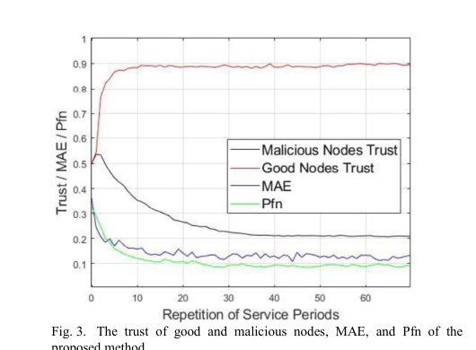
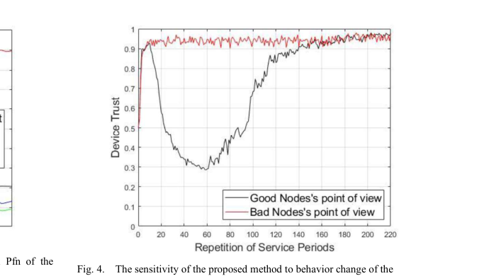
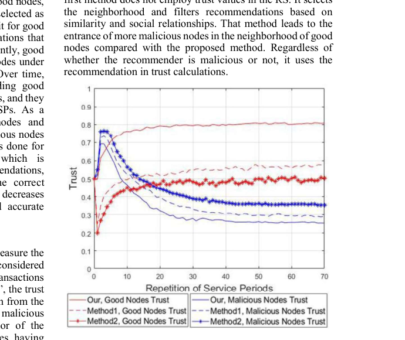
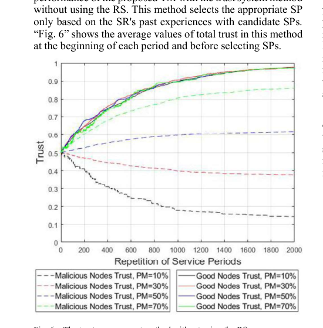

## Research Paper and Experimental Evaluation

The Java implementation presented in this repository is the implementation of the trust management and recommendation approach evaluated in the research paper:

**Improving Trust Management in Social Internet of Things by Filtering Inappropriate Recommendations**

The paper investigates how trust management can improve the reliability of service recommendations in the Social Internet of Things (SIoT). The proposed approach combines direct and indirect trust information with social relationships between devices. Its purpose is to identify reliable service providers, reduce the influence of malicious recommendations, and distinguish between trustworthy and untrustworthy devices.

The experimental evaluation examines the behavior of the implemented approach under different conditions, including malicious devices, changes in device behavior, and alternative recommendation strategies. The following figures are taken from the paper and present the experimental results.

### 1. Trust Convergence and Detection of Malicious Devices

This experiment evaluates how the trust values of good and malicious devices change as interactions take place. The simulation includes 110 devices, of which 33 are malicious.

The results show that the trust values of good devices gradually increase as they demonstrate reliable behavior. In contrast, the trust values of malicious devices decrease as their inappropriate behavior is detected through interactions and trust evaluation.

The figure also presents the Mean Absolute Error (MAE) and false-negative probability (Pfn). Their decreasing trends indicate that the system becomes more accurate over time and that the probability of incorrectly treating malicious devices as trustworthy is reduced.

**Result:** The proposed trust management approach can progressively distinguish reliable devices from malicious ones as more interaction information becomes available.

### 2. Trust Evaluation When a Device Changes Its Behavior

This experiment investigates whether the trust management approach can respond when a device changes its behavior.

The evaluated device behaves as a good device initially, becomes malicious between its 10th and 60th transactions, and then returns to good behavior. The results demonstrate how trust values respond to this change.

When the device starts behaving maliciously, the trust value observed by good devices decreases. After the device returns to good behavior, its trust value gradually recovers. According to the paper, the trust value exceeds 0.50 at approximately the 94th transaction.

The results also show a difference in how good and malicious devices evaluate the same device. Malicious devices may continue to assign higher trust because they do not identify the inappropriate behavior in the same way as good devices.

**Result:** The approach can adapt trust evaluations to changes in device behavior, although trust recovery requires additional interactions. It also illustrates why recommendations from unreliable devices need to be evaluated carefully.

### 3. Comparison with Alternative Recommendation Approaches

This experiment compares the proposed approach with two alternative methods:

- **Proposed method:** Uses trust values and social relationships when evaluating recommendations.
- **Method 1:** Does not use trust values in the recommendation system.
- **Method 2:** Does not use either trust values or social relationships in the recommendation system.

The experiment considers 110 devices, including 77 malicious devices. The comparison demonstrates the importance of evaluating recommendations before using them to calculate trust.

The proposed method provides better separation between good and malicious devices. In comparison, the alternative methods are more vulnerable to inappropriate recommendations because they do not apply the same trust-based filtering.

**Result:** Incorporating trust values and social relationships into recommendation evaluation helps reduce the influence of malicious recommendations and improves the reliability of the overall trust management process.

### 4. Trust Convergence Without the Recommendation System

This experiment evaluates trust convergence when the recommendation system is not used. It considers different proportions of malicious devices: 10%, 30%, 50%, and 70%.

Without recommendations, devices depend more heavily on their own direct interactions to evaluate other devices. As a result, trust information spreads more slowly through the network.

The results show that good devices can eventually achieve high trust values, but the convergence process takes considerably longer. This highlights the role of recommendations in accelerating trust evaluation by allowing devices to benefit from information gathered through other devices.

However, recommendations must be filtered appropriately. Otherwise, malicious devices may exploit the recommendation process to influence trust evaluations.

**Result:** The recommendation system improves the speed of trust convergence, provided that recommendations are evaluated and inappropriate ones are filtered before being used.

### Overall Findings

The experimental results demonstrate several important properties of the implemented approach:

- **Malicious-device detection:** Trust values progressively distinguish good devices from malicious devices.
- **Adaptability:** Trust evaluations respond when devices change their behavior.
- **Recommendation reliability:** Filtering recommendations using trust information and social relationships reduces the influence of malicious devices.
- **Faster convergence:** Using filtered recommendations helps devices reach reliable trust evaluations faster than relying only on direct interactions.

Together, these experiments evaluate the effectiveness of the implemented trust management and recommendation approach in different SIoT scenarios. They also demonstrate why combining direct trust, indirect trust, and social relationships is important when evaluating service providers and recommendations.

The figures and interpretations above are reproduced from the research paper's experimental evaluation. They represent the results reported in that study, rather than newly generated results from running the repository.